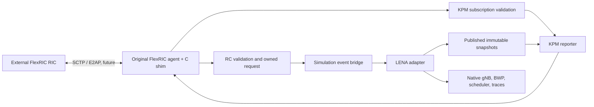

# Phase 01: independent interface architecture

Inspected on 2026-10-13. Scope: design, read-only adapter, build skeleton and smoke test. No E2 connection, indication pipeline, control execution or slicing implementation exists in this phase. All interface names below are proposed abstractions in `hero::oran`, not upstream classes. No Orange sources, external E2 simulator, RL or FL dependencies are used.

## Module boundaries

| Directory / abstraction | Responsibility and ownership |
|---|---|
| `e2-agent/` / E2Agent | Future C++ owner of a C11 FlexRIC shim, agent thread, connection and shutdown. Start/Stop are abstract only. |
| `common/` / E2NodeContext | Explicit PLMN and gNB ID separate from simulation node, cells, BWP indices and UE IDs. Initially monolithic gNB only. |
| `e2-agent/` / RanFunctionRegistry | Capability inventory consistent with plugin IDs, revisions, OIDs and setup definitions; never advertise unsupported operations. |
| `kpm/` / KpmMeasurementProvider | Immutable measurement snapshots published from the simulation thread. No protocol-thread ns-3 object access. |
| `kpm/` / KpmSubscriptionManager | Validate supported measurements, styles, periods and full subscription key, own per-node subscription state. |
| `kpm/` / KpmReporter | Convert validated snapshots into FlexRIC KPM structures. FlexRIC retains ASN.1 encoding and E2AP framing. |
| `control/` / RcControlHandler | Validate decoded RC request, own copied parameters, select target and dispatch; track queued versus applied outcomes. |
| `lena-adapter/` / LenaGnbAdapter | Native gNB/BWP access; future trace collection and explicitly supported scheduler changes on simulation thread. Current implementation only reads cells, BWP count and scheduler pointer. |
| `common/` / SimulationEventBridge | Bounded task queue, per-node order, dispatch to simulation events, shutdown rejection and cancellation policy. Abstract only. |
| `examples/`, `tests/`, `docs/` | Reproducible scenarios, focused checks and source-backed contracts. Only tests are implemented. |

Interfaces: [integration/common/interfaces.h](/home/hpclab-lananh/HERO-slicing/integration/common/interfaces.h). Adapter: [integration/lena-adapter/lena-gnb-adapter.h](/home/hpclab-lananh/HERO-slicing/integration/lena-adapter/lena-gnb-adapter.h) and [integration/lena-adapter/lena-gnb-adapter.cc](/home/hpclab-lananh/HERO-slicing/integration/lena-adapter/lena-gnb-adapter.cc). Empty module directories reserve boundaries; no hidden implementations.

## Time and dispatch

FlexRIC's `asio_agent.c` creates Linux timerfd-based reporting/retry events in wall time. The live native examples therefore use ns-3's existing realtime simulator and wait for E2 Setup before Run. ns-3's default simulator remains available for deterministic radio-only tests, but it is not used to claim a live RIC connection. Simulation sample bounds and wall-time overhead are recorded separately. Realtime scheduling is not a hard realtime guarantee.

Source: [platforms/flexric/src/agent/asio_agent.c](/home/hpclab-lananh/HERO-slicing/platforms/flexric/src/agent/asio_agent.c), [platforms/ns-3/src/core/model/realtime-simulator-impl.h](/home/hpclab-lananh/HERO-slicing/platforms/ns-3/src/core/model/realtime-simulator-impl.h), [platforms/ns-3/src/core/model/default-simulator-impl.cc](/home/hpclab-lananh/HERO-slicing/platforms/ns-3/src/core/model/default-simulator-impl.cc).

`Simulator::ScheduleWithContext(context, delay, task)` is documented thread-safe in [platforms/ns-3/src/core/model/simulator.h](/home/hpclab-lananh/HERO-slicing/platforms/ns-3/src/core/model/simulator.h), but the inspected realtime implementation did not reliably drain external-thread submissions while Run was active. The implemented bridge uses a mutex-protected per-gNB owned queue and an ns-3 event scheduled on startup to poll it. Protocol workers copy control values into this queue; only its simulation-thread event reads or changes scheduler state. The dispatch uses a bounded completion wait and cancels a timed-out task before it can mutate LENA. It does not guarantee a specific radio slot boundary.

Snapshots carry nanosecond interval bounds and sequence numbers. Protocol callbacks copy published data under a short lock; stale or absent samples must be represented explicitly. Copy decoded control data before returning: RC frees it immediately after the callback. No ns-3 Ptr or borrowed FlexRIC buffer crosses into owned task payloads.

## Lifecycle contract

1. Build native devices via NrHelper, configure BWPs and call UpdateConfig; discover identifiers before agent startup.
2. Freeze validated registry and callbacks. Create one protocol worker per gNB after its node context is ready. Await Setup readiness outside Run with a bounded timeout; partial-E2 test mode may continue with independently failed agents.
3. Publish snapshots on simulation events; protocol callbacks read published copies and enqueue owned controls. Revalidate supported BWP and control bounds before applying.
4. Close each control queue during cleanup and clear pending work. Subscription deletion is handled by original FlexRIC and is exercised before normal xApp/RIC shutdown in the live tests.
5. Stop/join each agent and the snapshot reader before Simulator::Destroy disposes devices. Failed peer cleanup is tested independently.

The public wrapper around FlexRIC's singleton does not reset its global state and cannot represent concurrent live gNB agents. Phase 06 instead uses the installed per-instance `e2_agent_t` API and direct endpoint lifecycle. The active implementation's setup failure, shutdown, normal stop, and sibling isolation paths are covered; automatic reconnection and recovery after SCTP loss are not implemented.

Sources: [platforms/flexric/src/agent/e2_agent.c](/home/hpclab-lananh/HERO-slicing/platforms/flexric/src/agent/e2_agent.c), [platforms/flexric/src/agent/e2_agent_api.c](/home/hpclab-lananh/HERO-slicing/platforms/flexric/src/agent/e2_agent_api.c), [platforms/ns-3/contrib/nr/model/nr-gnb-net-device.cc](/home/hpclab-lananh/HERO-slicing/platforms/ns-3/contrib/nr/model/nr-gnb-net-device.cc).

## Multi-gNB runtime model (Phase 06)

Assign each gNB a unique configured `(PLMN, gNB ID)` and keep simulator node ID, native cell IDs and BWP map separate. IMSI is stable UE identity; RNTI is cell-scoped and reusable. Track handover/release lifecycle and LCID/DRB separately. Do not equate ns-3 cell ID, IMSI or RNTI with a standards-complete E2 UE identity.

Phase 06 uses one original FlexRIC `e2_agent_t` instance and one protocol worker per native gNB inside a single simulator process. Each C++ `FlexricE2Agent` owns a KPM sequence context, identity, SCTP endpoint, state, provider pointer, control queue, and stop lifecycle. FlexRIC callback routing uses the worker's thread-local current-agent binding; the RAN function callback table is shared as code but each callback resolves only that worker's context. KPM/RC plugin handles remain loaded for the agent lifetime. The executable validates 2-node simultaneous operation end to end; three nodes complete E2 Setup, but the installed stock monitoring xApp did not sustain three concurrent subscriptions in our run (see Phase 06 validation).

Each gNB receives a distinct `(PLMN, gNB ID)` while its simulation node ID and cell ID remain separate. UE contexts use IMSI and the serving cell observed from the attached UE; each provider only emits UE rows for its own serving cell. The multi-cell example creates independent agents and providers in vectors indexed by native gNB. A malformed or failed gNB must only update its own agent state and close its own association. The implementation is per-instance, but the explicit “one peer fails while another keeps reporting” network-fault test remains to be added.

## Build and extension

The standalone CMake project imports existing debug shared ns-3 libraries and original FlexRIC static archives without reconfiguring upstream projects. C11 probe contains FlexRIC headers; C++20 code contains LENA headers. Future shim will expose only owned opaque handles/POD contracts through an extern-C boundary. No upstream code is copied.

Native scratch integration supports per-directory CMakeLists for external libraries: [platforms/ns-3/scratch/CMakeLists.txt](/home/hpclab-lananh/HERO-slicing/platforms/ns-3/scratch/CMakeLists.txt). Module/examples use build_lib/build_lib_example, as demonstrated by [platforms/ns-3/contrib/nr/CMakeLists.txt](/home/hpclab-lananh/HERO-slicing/platforms/ns-3/contrib/nr/CMakeLists.txt) and [platforms/ns-3/contrib/nr/examples/CMakeLists.txt](/home/hpclab-lananh/HERO-slicing/platforms/ns-3/contrib/nr/examples/CMakeLists.txt). An optional future launcher can attach the independent library this way; Phase 01 leaves upstream CMake untouched. Generated ns3Config is installation-oriented and references ns3Targets beside it; the current build tree does not provide that pair at its root. We use explicit imports for the inspected build, not an assumed usable package export.

Phases 04–07 implement the KPM path and two-node control validation using this separation: original FlexRIC owns KPM ASN.1/E2AP and subscription lifecycle, while per-gNB LENA providers publish native snapshots. See [protocol workflow](e2-protocol-workflow.md), [multi-gNB architecture](multi-gnb-architecture.md), [installation and execution](installation-execution.md), [troubleshooting](troubleshooting.md), [API compatibility](api-compatibility.md), [measurement mapping](measurement-mapping.md), [control capabilities](control-capabilities.md), and [Phase 06 validation](phase06-validation.md).
