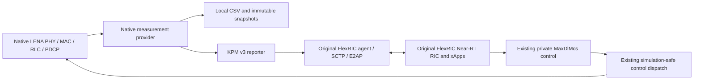
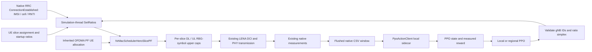

# HERO-Slicing learning and LENA integration architecture

This document describes how the HERO learning components and experimental slice-budget extension fit around the repository's existing native 5G-LENA and original FlexRIC integration. It distinguishes the live local simulator policy path from E2 control and records remaining methodology limits.

## Design intent

The supplied HERO design keeps native 5G-LENA's carrier/BWP configuration, bearer handling, and UE-level scheduler policy. A controller chooses a normalized per-slice resource ratio; a gNB-side manager validates the slice context and turns ratios into slice budgets; the native scheduler continues to allocate resources among UEs within those limits. PPO is a controller for these ratios, not a replacement for the LENA scheduler.

The current verified radio profile is still one shared 20 MHz BWP at 3.5 GHz. Slice identities are independent of BWP IDs and 5QI/QCI. The present experimental scheduler enforces upper caps within that shared BWP. It does not statically divide spectrum into slice-specific BWPs, modify the original BWP Manager, or promise minimum resource guarantees.

## Components and file boundaries

| Component | Current implementation | Responsibility and relationship to original LENA/FlexRIC |
|---|---|---|
| Native measurement collection | [`kpm/lena-measurement-provider.cc`](../kpm/lena-measurement-provider.cc), [`kpm/measurement-csv.cc`](../kpm/measurement-csv.cc) | Reads native LENA traces and counters on simulation events and publishes/captures per-gNB/per-UE measurement windows. Original provider path is preserved. |
| State construction | [`learning/state.py`](../learning/state.py), [`learning/state_cli.py`](../learning/state_cli.py) | Converts real measurement CSV rows to fixed-schema local or regional observations with availability masks. It does not create synthetic state or reward. |
| PPO policy | [`learning/hero_ppo.py`](../learning/hero_ppo.py) | Implements the Dirichlet actor, critic, PPO update, transition schema, checkpointing, and explicitly experimental reward helper. The user approved the Dirichlet policy and configurable experimental reward. |
| Local tier | [`learning/tiers.py`](../learning/tiers.py), `LocalPpoAgent` | One local policy/action group for one gNB context. It produces one eMBB/URLLC/mMTC ratio vector. |
| Regional tier | [`learning/tiers.py`](../learning/tiers.py), `RegionalPpoAgent` | One regional actor with an independent ratio group per active gNB, keyed in stable sorted gNB-ID order. It does not arbitrate against the local actor. |
| Slice association and budgets | [`slicing/slice-budget-manager.h`](../slicing/slice-budget-manager.h), [`slicing/slice-budget-manager.cc`](../slicing/slice-budget-manager.cc) | Owns per-gNB IMSI/RNTI-to-slice mapping, validates the three-ratio simplex, stores policy metadata, calculates budgets, and records usage. Methods are for the simulation thread. |
| LENA scheduler extension | [`slicing/nr-mac-scheduler-hero-slice-pf.h`](../slicing/nr-mac-scheduler-hero-slice-pf.h), [`slicing/nr-mac-scheduler-hero-slice-pf.cc`](../slicing/nr-mac-scheduler-hero-slice-pf.cc) | Derives from native `NrMacSchedulerOfdmaPF`. Calls inherited PF allocation, then trims registered UE grants that exceed their slice cap. The normal native scheduler remains the default. |
| Scenario binding | [`examples/native-measurements.cc`](../examples/native-measurements.cc) | Selects the custom scheduler only when `--enableSliceEnforcement=1`, gives every gNB its own manager, and maps successful RRC connection events to configured UE slice IDs. |
| Live PPO bridge | [`learning/ppo-action-client.h`](../learning/ppo-action-client.h), [`learning/ppo-action-client.cc`](../learning/ppo-action-client.cc), [`learning/runtime_controller.py`](../learning/runtime_controller.py) | Sends flushed native measurement windows to the local sidecar, receives validated per-gNB ratios, records action-aligned transitions, trains/checkpoints PPO, and applies ratios from the simulation event callback. |
| Build registration | [`CMakeLists.txt`](../CMakeLists.txt) | Builds the independent slice library against the existing native ns-3 NR/core libraries and links it to the scenario. No LENA/FlexRIC upstream source is replaced. |
| GUI configuration | [`dashboard/index.html`](../dashboard/index.html), [`dashboard/server.py`](../dashboard/server.py) | Exposes opt-in enforcement, PPO tier/mode, update interval, seed and experimental reward weights; validates inference checkpoints and passes options to the simulator. |
| Existing E2 agent and RIC interface | [`e2-agent/`](../e2-agent), [`control/`](../control), [`kpm/`](../kpm) | Continues to use original FlexRIC SCTP/E2AP/KPM libraries. The tested private RC extension changes `MaxDlMcs`; it is not a slice-ratio E2 control. |

## Existing native path and added path

The original integration path remains:



The added slice enforcement path remains opt-in. When live PPO is disabled, the initial ratios remain fixed. When enabled, the bridge below supersedes them after the first complete measurement window:



PPO updates use local process IPC and apply through `SliceBudgetManager::SetRatios(ratios, policyVersion, source)` on the simulation thread. They do not use or modify the FlexRIC E2 path. In regional mode, one aligned action vector is returned for each gNB; in local mode, each gNB owns a separate actor/checkpoint. The selected mode is exclusive.

## Observation, action, and learning contract

`HeroStateBuilder` constructs the local 62-scalar observation from 31 feature/value-availability pairs. The regional observation concatenates up to the configured gNB count and a presence bit per slot; stable external gNB IDs preserve action identity. Current features include native SINR/CQI/MCS, active/connected UEs, delivered PDCP throughput and delay, PRB grant counters, BWP available PRBs, previous applied ratios, and configured throughput-target gaps. Unsupported BLER, HARQ, queue occupancy, packet-loss, and end-to-end delay terms remain masked/unavailable.

`SliceRatioPPO` produces a three-element simplex for each active action group. The Dirichlet distribution is an approved experimental policy choice because the supplied model defines ratio constraints but no policy distribution. The live recorder aligns each applied action with the next actual native measurement window and writes transition JSONL containing observation, action, old log probability, measured reward, next observation, simulation time, policy version, and gNB IDs. CSV replay without actions is still not treated as an environment.

The live reward uses explicitly configured experimental coefficients, measured throughput normalized to 100 Mbit/s, delay normalized to 1,000 ms, positive configured throughput targets, and ratio-change cost. Regional mode currently averages normalized cell and UE terms across active nodes. The design's ConvexSolve objective/constraints and final reward coefficients are not specified by available materials; these live reward details are disclosed experiment choices, not paper claims. Local and regional modes are mutually exclusive per run, so no precedence arbitration is performed. Simplex validation is currently the only feasibility validation before ratios reach the manager.

The sidecar is synchronously queried from the simulation event callback. This guarantees scheduler mutation stays on the simulation thread, but PPO evaluation/update time pauses simulator event processing. PPO can thus slow unpaced simulation work and cause real-time lag if combined with E2; radio-only training is the verified high-speed path. The Python child starts before FlexRIC and measurement-reader threads to avoid forking a multithreaded process.

## Scheduler budget semantics

For a selected slice ratio `alpha_s`, configured scheduler RBG count `N_RBG`, and current available symbol count `symAvail`, the current experimental cap is:

```text
RBG-symbol cap(s) = floor(alpha_s * N_RBG) * symAvail
```

The unit is RBG-symbol opportunities, not raw PRBs, BWP bandwidth, utilization, or a guarantee. DL and UL are counted separately. LENA's inherited PF scheduler chooses UE allocations first; the extension trims lower-priority PF grants within any over-budget slice. Unused cap is not borrowed by other slices in this version. Whole-symbol grant granularity can leave capacity unused. Any unregistered RNTI retains inherited PF behavior; static scenarios register configured UEs from the actual gNB RRC connection trace. Handover migration is not implemented in this mode.

This is a scheduler-side resource cap within the current BWP. It does not change bandwidth/numerology, RRC bearer mapping, the original BWP Manager, native PHY behavior, or the default scheduler selection.

## Status compared with original LENA + FlexRIC integration

| Capability | Status |
|---|---|
| Native UE slice labels, QoS profiles and bearer setup | Implemented as scenario metadata and traffic/bearer configuration; slice ID is not a standardized 5QI identity. |
| Per-gNB Slice Manager and RNTI mapping | Implemented for static-attachment scenarios; one independent manager per gNB. |
| Native UE scheduler behavior | Inherited from OFDMA PF, followed by opt-in budget trimming. Baseline is unchanged when the option is off. |
| Initial ratio configuration in dashboard/scenario | Implemented; ratios initialize each manager and remain fixed if PPO is disabled. |
| Runtime ratio update API | Implemented; PPO actions call it on the simulator event thread after C++ identity/simplex validation. |
| Local/regional PPO model and observation builders | Implemented and used by the live controller; the selected tier writes checkpoints and actual transitions. |
| Live PPO observation/action/reward loop | Implemented and validated for one-gNB local and two-gNB regional radio-only runs. Reward coefficients are configurable experiments, not final HERO methodology. |
| E2 KPM telemetry and existing RC control | Existing FlexRIC-backed paths remain. KPM remains the previously supported set; RC remains the private `MaxDlMcs` operation. |
| Slice-ratio control over E2 | Not implemented or advertised; live PPO uses local simulator IPC. |
| Dynamic BWP reassignment, minimum slice guarantees, borrowing, handover-aware slice movement | Not implemented. |

## Source and validation references

The adapter is based on native LENA scheduler APIs in [`NrMacSchedulerOfdmaPF`](../../platforms/ns-3/contrib/nr/model/nr-mac-scheduler-ofdma-pf.h), [`NrMacSchedulerOfdma::AssignDLRBG/AssignULRBG`](../../platforms/ns-3/contrib/nr/model/nr-mac-scheduler-ofdma.cc), and `NrHelper::SetSchedulerTypeId` / `GetScheduler` in [`nr-helper.h`](../../platforms/ns-3/contrib/nr/helper/nr-helper.h). UE slice registration uses the native `ConnectionEstablished` trace declared by [`nr-gnb-rrc.h`](../../platforms/ns-3/contrib/nr/model/nr-gnb-rrc.h). Existing FlexRIC compatibility and API findings are in [`api-compatibility.md`](api-compatibility.md) and [`e2-protocol-workflow.md`](e2-protocol-workflow.md).

Build and run the focused checks from the repository root:

```bash
cmake -S integration -B integration/build
cmake --build integration/build --target native-measurements slice-budget-manager-test -j2
ctest --test-dir integration/build -R 'slice-budget-manager-unit|native-slice-budget-enforcement|native-multignb-slice-budget|dashboard-server-behavior|ppo-learning-unit|native-live-ppo-budget' --output-on-failure
```

The single- and two-gNB enforcement scenarios require actual DL/UL traffic and verify cumulative use does not exceed each per-gNB directional slice budget. The live PPO test additionally verifies real local and regional actions, saved transitions, and checkpoints. See [`slice-manager.md`](slice-manager.md) for scheduler limits and [`ppo-learning.md`](ppo-learning.md) for PPO commands and runtime details.
