# Live PPO slice-budget control — baseline formulation

The original local/regional observation and experimental reward documented here remain available as the `baseline` formulation for backward compatibility and controlled comparison. The new 144-value UE-aware local state, bounded Q/A/E/F/H reward, measured manager-window budget feedback, and separate checkpoint schema are documented in [UE-aware local PPO](ppo-ue-aware.md). The dashboard selects UE-aware for new local configurations; regional mode remains baseline-only.

PPO now controls the per-gNB slice budget ratios when explicitly enabled. Before this change, PPO actions were only standalone outputs and were not applied. The integrated path is opt-in and uses the existing native LENA provider, per-gNB `SliceBudgetManager`, and PF-derived scheduler. The original scheduler remains the default baseline, and E2/KPM/RC behavior is unchanged.

## Live path

For each gNB, the measurement provider emits a completed native measurement window and the CSV writer flushes its actual PHY/MAC/RLC/PDCP-derived records. `PpoActionClient` sends the new window to a Python controller sidecar. The controller builds observations from those real rows, computes the reward for the previously applied action, performs PPO updates when the configured rollout length is reached, and samples a three-slice Dirichlet ratio vector. The C++ bridge validates every gNB ID and ratio simplex again, then calls that gNB's `SliceBudgetManager::SetRatios(..., policyVersion, "ppo-<tier>")` directly from the ns-3 event callback. That budget is used by subsequent scheduler slots.

The initial configured ratios govern the first scheduler interval. Each later action is applied for the next scheduling interval. Regional mode waits until all gNBs have emitted the matching sequence, and returns one independently sampled ratio vector per stable gNB identity. Local mode maintains a separate policy and checkpoint for each gNB. Selecting a tier is exclusive; there is no local/regional arbitration.

```mermaid
flowchart LR
  LENA[Native LENA PHY/MAC/RLC/PDCP] --> PROVIDER[Per-gNB measurement provider]
  PROVIDER --> CSV[Flushed real measurement window]
  CSV --> IPC[Line-oriented PPO sidecar request]
  IPC --> STATE[Local or regional state builder]
  STATE --> PPO[Dirichlet PPO action and measured reward]
  PPO --> VALIDATE[C++ identity and simplex validation]
  VALIDATE --> MANAGER[Target gNB SliceBudgetManager::SetRatios]
  MANAGER --> SCHED[HeroSlicePF budget caps]
  SCHED --> LENA
```



The sidecar protocol is private local process IPC, not an E2 procedure. Slice ratios are not sent over E2SM-RC. Existing FlexRIC SCTP/E2AP/KPM and the private `MaxDlMcs` RC control remain separate and unmodified.

## Use from the native scenario

Build the updated integration binary:

```bash
cmake -S integration -B integration/build
cmake --build integration/build --target native-measurements -j2
```

Run a one-gNB local PPO training scenario with real traffic and explicit slice assignment:

```bash
integration/build/native-measurements \
  --gnbs=1 --ues=3 --duration=8 --sampleMs=200 \
  --sliceAssignment=explicit --embbUes=1 --urllcUes=1 --mmtcUes=1 \
  --enableSliceEnforcement=1 --enablePpo=1 --ppoTier=local --ppoMode=train \
  --ppoUpdateEvery=8 --ppoMaxEpisodes=100 --ppoEpisodeTransitions=32 --ppoSeed=1 \
  --ppoCheckpointDir=integration/build/ppo-checkpoints/local \
  --csv=integration/build/ppo-training.csv --enableE2=0 --realtime=0
```

For multi-gNB regional control, set `--gnbs=2 --ues=6`, use two UEs per slice, and set `--ppoTier=regional`. Regional checkpoints are specific to the configured maximum gNB count, for example `regional-gnbs-2.pt`. The local tier saves `local-gnb-101.pt`, `local-gnb-102.pt`, and so on. Training writes actual action-aligned transitions to `live-transitions.jsonl` in the checkpoint directory unless `--ppoExperienceFile` specifies another path.

After training, inference requires the corresponding checkpoint(s):

```bash
integration/build/native-measurements \
  --gnbs=2 --ues=6 --duration=8 --sampleMs=200 \
  --sliceAssignment=explicit --embbUes=2 --urllcUes=2 --mmtcUes=2 \
  --enableSliceEnforcement=1 --enablePpo=1 --ppoTier=regional --ppoMode=infer \
  --ppoCheckpointDir=integration/build/ppo-checkpoints/regional-gnbs-2 \
  --csv=integration/build/ppo-inference.csv --enableE2=0 --realtime=0
```

The dashboard exposes the PPO toggle, local/regional tier, train/infer mode, rollout size, seed, configurable reward weights, and local training episode limits. A local episode is explicitly defined as `ppoEpisodeTransitions` completed action-aligned windows; it is independent of `ppoUpdateEvery`. Since this native scenario has no reset API, episode boundaries preserve the continuing simulation and mark the final transition as truncated for bootstrapped GAE. After `ppoMaxEpisodes`, each local policy is frozen while the simulation continues. The pane plots the actual mean reward per transition against episode number, raw and smoothed gNB curves, and the recorded theoretical reward bounds for UE-aware local training. It shows current and best completed episode rewards, reward gap, environment transitions, and optimizer update count. Run and gNB filters are available. PPO losses remain separate optimizer diagnostics and are never interpreted as episodes. Regional PPO has a joint reward and does not claim per-gNB episode reward. Inference profiles are rejected unless matching checkpoints exist; inference applies actions but does not generate training reward/loss events. Dashboard profiles continue to save the training limits, and applied commands and PPO actions appear in the simulation log.

## Reward and observation limits

The default reward uses measured cell-level DL/UL delivered PDCP throughput normalized against a 100 Mbit/s engineering scale. Optional terms can include PDCP delay normalized against a 1,000 ms engineering scale, configured positive DL throughput-target satisfaction, and ratio-change cost (half the L1 distance between successive ratio vectors). In regional mode the current implementation averages these normalized cell/UE terms across the active gNBs/UE rows. These aggregation rules, coefficients, and scales are experimental software choices, not final paper constants. Reliability reward weight is required to remain zero because this provider does not expose packet-loss/reliability measurements. Missing observations retain their availability masks and are not fabricated.

The local schema contains 31 values plus 31 availability bits: native SINR/CQI/MCS, active and connected UEs, delivered PDCP throughput/delay, PRB grant data, configured BWP PRBs, previous budget ratios, and configured throughput-target gaps. The regional policy receives aligned observations for each active gNB and emits a distinct vector for each. The action is a normalized eMBB/URLLC/mMTC simplex; no ConvexSolve projection or additional constraints are invented.

## Scheduler semantics and limitations

`SliceBudgetManager` applies per-slot upper caps measured in RBG-symbol opportunities. LENA's inherited PF scheduler first chooses UE allocations; the HERO scheduler trims grants that exceed each slice's cap. Unused budget is not borrowed. This action changes budget ratios within the currently configured shared BWP. It does not reconfigure BWP bandwidth, add a minimum resource guarantee, change bearer mapping, or replace the native UE scheduler.

The bridge waits synchronously for the Python sidecar on the ns-3 simulation event thread. This keeps all LENA mutation simulation-thread-safe and makes each update deterministic, but sidecar inference/training pauses event processing while it runs. This can reduce throughput or cause lag in real-time E2-connected runs; use radio-only, unpaced execution for training speed. Regional control also waits for all gNB measurement callbacks for a sequence. The controller now emits framed `BUSY` heartbeats while processing; the bridge enforces a 30-second inactivity limit and a 10-minute hard request deadline, reports child/pipe failures, and never applies an old action after timeout. Shutdown gives the child a bounded graceful window before terminating it; it does not restart the controller or silently reset its optimizer. Failures are reported and abort the simulation rather than applying malformed or misrouted actions.

Training checkpoints are written after PPO updates. Any partial rollout shorter than `ppoUpdateEvery` at process shutdown is recorded as transitions but is not used for a final partial update. Deterministic inference does not train or append transition rewards. The Dirichlet action distribution was explicitly approved as an experiment because the HERO model specifies simplex ratios but no policy distribution. Reward constants and broader learning objectives still require validation against the authoritative HERO methodology before scientific claims.

## Verification

The focused test executes real single-gNB local and two-gNB regional LENA scenarios, checks that actual traffic produced measurements, verifies that every intended manager retains a `ppo-local` or `ppo-regional` source and policy ratios, and checks that transitions and checkpoints were saved:

```bash
ctest --test-dir integration/build -R 'native-live-ppo-budget|ppo-learning-unit|ppo-runtime-ipc|ppo-action-client-ipc-stress|dashboard-server-behavior' --output-on-failure
```

Successful runtime logs include `[HERO PPO] applied ... target=next-scheduler-slots`, PPO update metrics and measured update duration in training mode, `[HERO PPO IPC]` request/response timing, child PID, gNB/request context, pipe lifecycle, and final `HERO_SLICE_POLICY ... source=ppo-...` lines per gNB. The IPC stress test performs 60,010 two-gNB request/response exchanges with a protocol peer and measures latency, peak RSS, and file descriptors. It validates transport longevity, not 60,010 PPO transitions or 3,750 learned PPO updates; the native live test validates actual PPO-to-LENA updates at its shorter regression scale.
